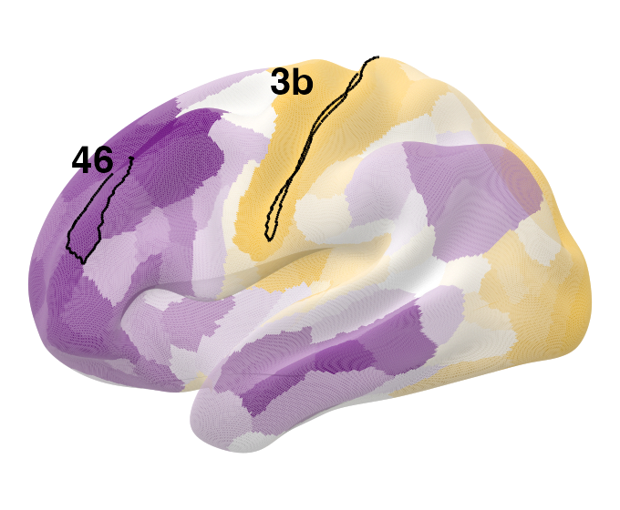
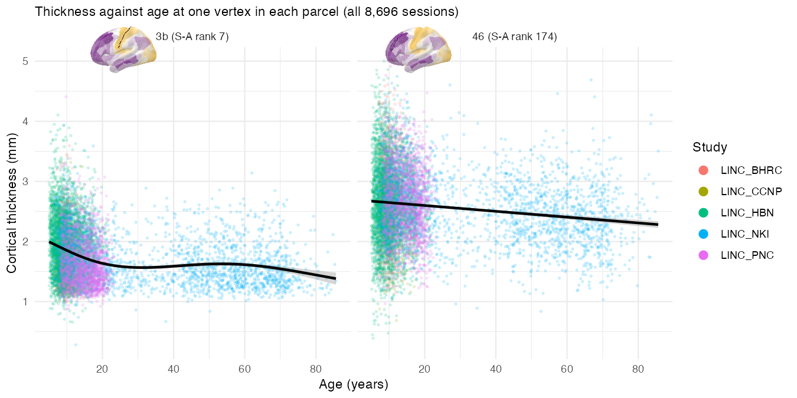
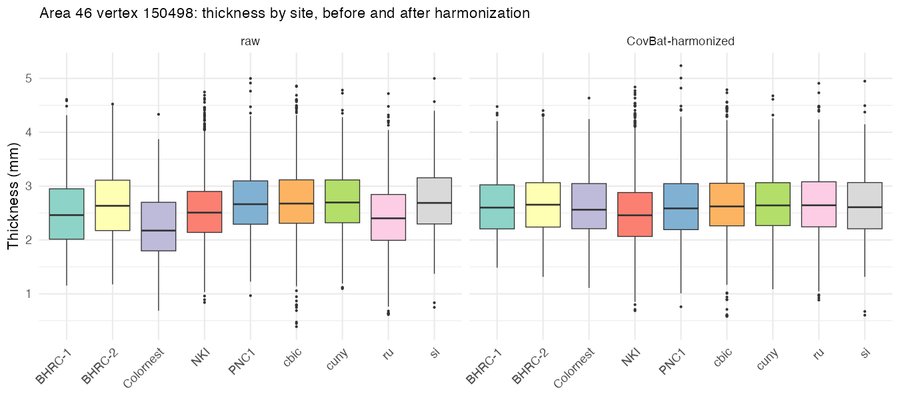
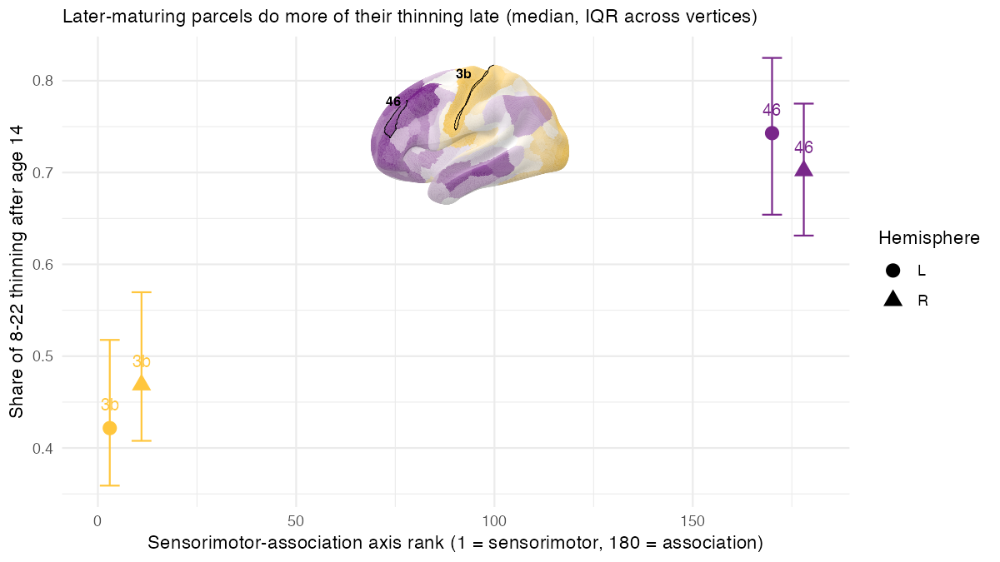
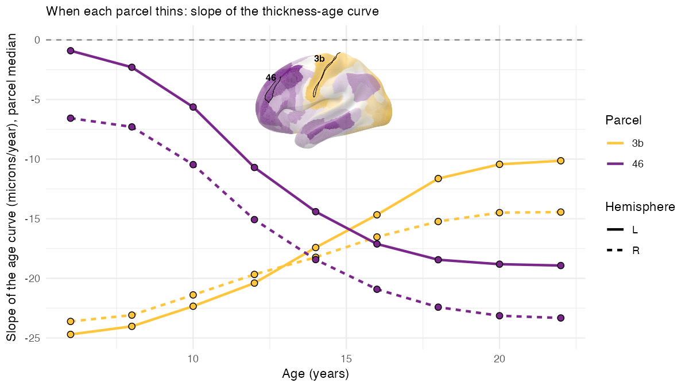

# Cloud TileDB: RBC Cortical Thickness from S3

[](https://mybinder.org/v2/gh/PennLINC/ModelArray/tiledb-example?urlpath=rstudio)

The [Reproducible Brain Charts](https://reprobrainchart.github.io/)
(RBC) FreeSurferPost release is available as a TileDB store on a public
S3 bucket: 70 surface measures, each 327,684 fsLR-164k vertices by 8,696
sessions from five studies (BHRC, CCNP, HBN, NKI, PNC; ages 5–85). That
is 553 GB. This article is about a report you can run yourself that fits
models to those data **without downloading them**: ModelArray reads the
handful of tiles it needs, straight from S3, and leaves the rest where
it is.

The report asks a question with a known answer, so you can tell whether
it worked. The cortex thins through childhood and adolescence, but not
everywhere at the same time: primary sensory cortex matures first and
has little thinning left after mid-adolescence, while association cortex
keeps thinning through the teens and into the twenties (Shaw et al.,
2008; Tamnes et al., 2017). Sydnor et al. (2021) order every region
along a sensorimotor–association (S-A) axis, from sensory and motor
cortex at one end to prefrontal association cortex at the other. Put
together: **a parcel near the sensorimotor end should do most of its
thinning early, and one near the association end should do most of it
late.** The report tests this on two Glasser parcels at opposite ends of
the axis — area 3b (primary somatosensory, rank 7) and area 46
(dorsolateral prefrontal, rank 174) — one vertex at a time, and never on
the whole cortex.

## What the report does

1.  Points TileDB at the bucket (two config settings, no AWS account).
2.  Lists the store with
    [`ModelArraySummary()`](https://pennlinc.github.io/ModelArray/reference/ModelArraySummary.md),
    opens `thickness` with
    [`ModelArray()`](https://pennlinc.github.io/ModelArray/reference/ModelArray-class.html),
    and downloads the cohort CSV (age, sex, site).
3.  Works out, before reading anything, how many tiles each parcel
    touches and how many megabytes that is.
4.  Looks at single vertices with
    [`exampleElementData()`](https://pennlinc.github.io/ModelArray/reference/exampleElementData.md):
    thickness against age, a GAM with site as a covariate, its
    derivative, and a mixed model for repeat sessions.
5.  Reads each parcel’s vertices from S3 in one go and harmonizes them
    across the nine scanning sites with CovBat
    (`ComBatFamily::covfam()`, keeping `s(Age, k = 4) + sex`), then
    writes the raw and harmonized blocks into a small local ModelArray
    store.
6.  Runs
    [`ModelArray.gam()`](https://pennlinc.github.io/ModelArray/reference/ModelArray.gam.md)
    straight from S3 on one parcel (site as a covariate) and on the
    local store for every parcel, raw and harmonized, to show what
    harmonization changes; then
    [`ModelArray.wrap()`](https://pennlinc.github.io/ModelArray/reference/ModelArray.wrap.md)
    with a custom `fit_vertex()` that adds an `fx = TRUE` test
    statistic, ΔR²adj, predicted thickness every two years and the
    derivative of the age curve with a simultaneous interval, for ages
    5–23.
7.  Summarizes per parcel, plots the late fraction of thinning and the
    slope-by-age curves against S-A rank, and compares them with the
    literature.
8.  Writes CSVs, saves the results into the local store with
    [`writeResults()`](https://pennlinc.github.io/ModelArray/reference/writeResults.md),
    and exports CIFTI dscalars plus `.spec` files for Connectome
    Workbench.
9.  Prints how long each step took and how many bytes came over the
    wire.

## Run it

### In the browser

Click the Binder badge at the top. After a minute or two RStudio opens
with `~/rbc_s3_example/rbc_s3_tiledb_example.Rmd` ready; open it and
press **Knit**. Binder gives one core and about 2 GB of memory, so the
report detects it and uses its smallest settings (three left-hemisphere
parcels, one tile each). Expect 10–15 minutes. Binder sessions are
public and disappear after ten idle minutes, so download anything you
want to keep (the `rbc_s3_example` folder has the HTML, CSVs and CIFTI
files).

### On your own machine

You need ModelArray from the GitHub main branch (TileDB support), the
TileDB packages, and a few modelling packages:

``` r

install.packages(c("tiledb", "jsonlite", "mgcv", "ggplot2", "gratia", "gamm4", "lme4", "rmarkdown", "cowplot", "png"))
BiocManager::install("TileDBArray")
remotes::install_github("andy1764/ComBatFamily")
remotes::install_github("PennLINC/ModelArray")
```

[Connectome
Workbench](https://www.humanconnectome.org/software/get-connectome-workbench)
is optional; with `wb_command` on your PATH the report writes the CIFTI
files and a `.spec` you can open in `wb_view`. Then render:

``` r

example <- system.file("examples/rbc-s3-tiledb/rbc_s3_tiledb_example.Rmd", package = "ModelArray")
out_dir <- path.expand("~/rbc_s3_example")
dir.create(out_dir, recursive = TRUE, showWarnings = FALSE)

# quick: areas 3b and 46 in the left hemisphere, two tiles per parcel
rmarkdown::render(example, output_dir = out_dir, knit_root_dir = out_dir, intermediates_dir = tempdir(),
                  params = list(quick = TRUE, n_cores = 4, out_dir = out_dir))

# full: areas 3b and 46 in both hemispheres, six tiles per parcel
rmarkdown::render(example, output_dir = out_dir, knit_root_dir = out_dir, intermediates_dir = tempdir(),
                  params = list(quick = FALSE, n_cores = 8, out_dir = out_dir))
```

Other parameters (`parcels`, `hemispheres`, `max_tiles_per_parcel`,
`max_vertices_per_parcel`, `harmonize`, `write_cifti`, `allocation_mb`)
are listed at the top of the Rmd. The report never writes to S3;
everything lands in `out_dir`.

## What to expect

Numbers from runs on an Apple-silicon Mac (14 cores, 36 GB; the report
used 8 cores).

|  | Quick | Full |
|----|----|----|
| Parcels | 3b, 46 (left) | 3b, 46 (both hemispheres) |
| Vertices analysed | 600 | 2,000 |
| Read from S3 | 296 MB (2 tiles per parcel) | 996 MB (6 tiles per parcel) |
| CovBat | 2.5 min on 2 cores | 4.1 min on 4 cores |
| `fit_vertex()` at every vertex | 42 s | 3.6 min |
| Whole report | 8 min | 20 min |

The full thickness scalar is 10.6 GB and the whole store 553 GB, so the
full run reads about 0.2% of the store.

Every tile check passed: each parcel read exactly the tiles predicted
before reading. The derivative of the age curve matches
`gratia::derivatives()` to about 1e-9 mm/yr.

The literature check passes. Area 3b (sensorimotor) does most of its
thinning early and area 46 (association) does most of its late: the
share of the 8–22 thinning that happens after age 14 is about 0.4 in 3b
and about 0.7 in 46 (Spearman ρ = 0.89 across the four
parcel-hemispheres; age of fastest thinning ρ = 1.00):

| Parcel | S-A rank | Late fraction (L / R) | Age of fastest thinning | Slope no longer clearly negative after |
|----|----|----|----|----|
| 3b | 7 | 0.41 / 0.48 | 5 y | 19–23 y |
| 46 | 174 | 0.74 / 0.71 | 23 y | still thinning at 23 |

Area 3b thins fastest in early childhood and is nearly flat by the late
teens; area 46 thins slowly in childhood and fastest in the late teens
and twenties — exactly the sensorimotor-first, association-last ordering
of the S-A axis.

The S-A axis and the two parcels, in the colour scheme of Sydnor et
al. (2021, Figure 2A) — gold at the sensorimotor pole, purple at the
association pole:











## How it works

**Reaching the bucket.** ModelArray uses the `tiledb` package’s default
context. Set the region and anonymous access on it once, before
[`ModelArray()`](https://pennlinc.github.io/ModelArray/reference/ModelArray-class.html):

``` r

cfg <- tiledb::tiledb_config()
cfg["vfs.s3.region"] <- "us-east-1"
cfg["vfs.s3.no_sign_request"] <- "true"
tiledb::tiledb_ctx(cfg)

uri <- "s3://fcp-indi/data/Projects/RBC/RBC_FreeSurfer-Post_ModelArray/rbc_freesurferpost.tdb"
ModelArraySummary(uri)
ma <- ModelArray(uri, scalar_types = c("thickness", "curv"))
```

The environment variables `TILEDB_VFS_S3_REGION` and
`TILEDB_VFS_S3_NO_SIGN_REQUEST` do the same thing. For a private bucket,
use your usual AWS credentials instead of `no_sign_request`.

**Tiles are the unit of cost.** The store is dense float32, tiled as 964
vertices by all 8,696 sessions (33.5 MB before compression, 4–8 MB on
the wire). Reading one vertex reads its tile, so `element.subset` ranges
that fall in the same tile are nearly free, and a parcel whose vertices
are spread over 20 tiles costs 20 tiles. The report prints this
arithmetic before it reads, and caps each parcel at its most populated
tiles.

**One read pass per query.** The `tiledb` R package reads a query in
passes whose size is set by
[`tiledb::set_allocation_size_preference()`](https://tiledb-inc.github.io/TileDB-R/reference/save_allocation_size_preference.html)
(10 MiB by default). Each pass re-fetches the tiles it touches, so with
the default a 3-tile read can download 18 tiles. The report sets 512 MB;
the report’s runtime table checks that the number of tiles read matches
the prediction. This is separate from
`options(ModelArray.tiledb_read_block_mb)`, which controls how many
elements ModelArray asks for at once (see
[`vignette("large-scale-analyses")`](https://pennlinc.github.io/ModelArray/articles/large-scale-analyses.md)).

**Results stay local.**
[`writeResults()`](https://pennlinc.github.io/ModelArray/reference/writeResults.md)
writes to a local `.h5` (or `.tdb`); the S3 store is never written to.

**Why CovBat on a parcel at a time.** Nine sites differ in both the mean
and the spread of thickness, so a `site` covariate is not enough. CovBat
harmonizes mean, variance and the covariance between features across
sites. Harmonizing vertex by vertex inside the per-element function
would work, but it is slow (one GAM fit per vertex just for the
correction) and leaves nothing for the empirical-Bayes step to pool
across. Reading a parcel’s vertices as one block and harmonizing them
together is the method’s intended use, costs one `covfam()` call per
parcel, and the harmonized block goes into a local HDF5 store that
ModelArray reads like any other. Parcels are harmonized independently,
so the report runs them in parallel, one per core
([`parallel::mclapply()`](https://rdrr.io/r/parallel/mclapply.html);
serially on Windows and on Binder). CovBat keeps every per-vertex GAM
fit, so the report drops the copies of the data each fit carries, which
`covfam()` never uses again; the harmonized values are unchanged, and
each worker needs about 1 GB per 300 vertices. Repeat sessions (BHRC,
NKI) are treated as independent, which the report says plainly and
contrasts with a one-vertex longitudinal ComBat + GAMM fit.

**One scalar at a time.** ModelArray can attach a second scalar as an
element-wise covariate when it lists the same source files as the
phenotypes. In this store every scalar has its own file per session, so
`curv` cannot ride along with `thickness`; the report uses thickness
alone.

**GAM choices.** `s(Age, k = 4)` with REML, following PennLINC practice:
a developmental curve needs at most two or three bends. Penalized
p-values can be optimistic, so the test statistic comes from an
`fx = TRUE` refit. Effect size is the change in adjusted R² when the
smooth is dropped (what `changed.rsq.term.index` gives in
[`ModelArray.gam()`](https://pennlinc.github.io/ModelArray/reference/ModelArray.gam.md)).
Direction and timing come from the derivative of the fitted curve with a
simultaneous interval (the same construction as
`gratia::derivatives()`).

## See also

- [`vignette("large-scale-analyses")`](https://pennlinc.github.io/ModelArray/articles/large-scale-analyses.md)
  for memory and block-size settings on big stores.
- [`vignette("modelling")`](https://pennlinc.github.io/ModelArray/articles/modelling.md)
  for
  [`ModelArray.gam()`](https://pennlinc.github.io/ModelArray/reference/ModelArray.gam.md),
  [`ModelArray.wrap()`](https://pennlinc.github.io/ModelArray/reference/ModelArray.wrap.md)
  and the streaming-harmonization case study.
- [`vignette("modelarray-storage")`](https://pennlinc.github.io/ModelArray/articles/modelarray-storage.md)
  for the HDF5 and TileDB layouts.
- The example folder:
  `system.file("examples/rbc-s3-tiledb", package = "ModelArray")`,
  including the provenance of the vendored Glasser-164k labels and S-A
  ranks.

## References

- Bethlehem RAI et al. (2022). Brain charts for the human lifespan.
  *Nature* 604, 525–533.
- Glasser MF et al. (2016). A multi-modal parcellation of human cerebral
  cortex. *Nature* 536, 171–178.
- Sydnor VJ et al. (2021). Neurodevelopment of the association cortices.
  *Neuron* 109, 2820–2846.
- Shaw P et al. (2008). Neurodevelopmental trajectories of the human
  cerebral cortex. *J Neurosci* 28, 3586–3594.
- Tamnes CK et al. (2017). Development of the cerebral cortex across
  adolescence. *J Neurosci* 37, 3402–3412.
- Chen AA et al. (2022). Mitigating site effects in covariance for
  machine learning in neuroimaging data. *Hum Brain Mapp* 43, 1179–1195.
  (CovBat)
