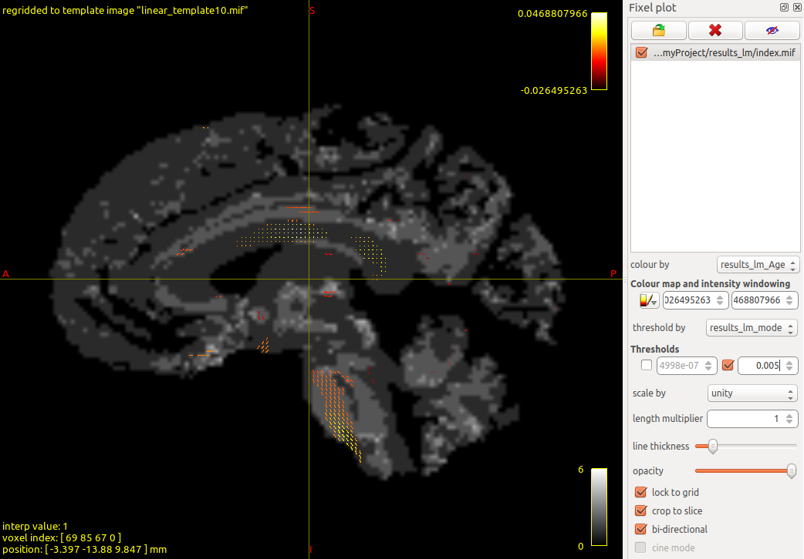

This walkthrough takes you from raw fixel data to statistical results in three steps. We use demo fixel-wise FDC data from 100 subjects (ages 8–22) from the Philadelphia Neurodevelopmental Cohort.

For deeper background on the concepts here, see the [Introductions](../articles/elements.html) vignettes. For more modelling options (GAMs, custom functions), see `vignette("modelling")`.

<style>
.tiledb-toggle {
  background-color: #eaf4ff;
  border-left: 4px solid #2b6cb0;
  border-radius: 6px;
  margin: 1rem 0;
  padding: 0.75rem 1rem;
}

.tiledb-toggle summary {
  cursor: pointer;
  font-weight: 700;
}
</style>

## Step 1. Prepare data and convert to HDF5

### Download the demo data

```{.console}
$ mkdir ~/Desktop/myProject && cd ~/Desktop/myProject
$ wget -cO - https://osf.io/tce9d/download > download.tar.gz
$ tar -xzf download.tar.gz && rm download.tar.gz
```

This gives you a folder of fixel `.mif` files and a cohort CSV:

```{.console}
~/Desktop/myProject/
├── cohort_FDC_n100.csv
└── FDC/
    ├── index.mif
    ├── directions.mif
    ├── sub-010b693.mif
    ├── sub-0133f31.mif
    └── ...
```

### The cohort CSV

The CSV file contains one row per subject with columns for covariates and two required columns:

- `scalar_name`: the metric name (e.g., `FDC`)
- `source_file`: path to that subject's data file, either absolute or relative
  to the directory from which `modelarrayio` is run

| subject_id  | Age  | sex | dti64MeanRelRMS | scalar_name | source_file         |
|:-----------:|:----:|:---:|:---------------:|:-----------:|:-------------------:|
| sub-6fee490 | 8.83 |  2  |    0.863669     |     FDC     | FDC/sub-6fee490.mif |
| sub-647f86c | 8.50 |  2  |    1.775610     |     FDC     | FDC/sub-647f86c.mif |
| ...         | ...  | ... |       ...       |     ...     | ...                 |

### Convert to HDF5

Use the `modelarrayio to-modelarray` command from [ModelArrayIO](https://github.com/PennLINC/ModelArrayIO) to convert the `.mif` files into an HDF5 file (see `vignette("modelarray-storage")` for what this file contains):

```{.console}
$ conda activate modelarray
$ modelarrayio to-modelarray \
    --backend hdf5 \
    --index-file FDC/index.mif \
    --directions-file FDC/directions.mif \
    --cohort-file cohort_FDC_n100.csv \
    --output demo_FDC_n100.h5
```

<details class="tiledb-toggle">
<summary><strong>TileDB</strong></summary>

Use `--backend tiledb` to create a directory-backed TileDB ModelArray store
instead of a single `.h5` file:

```{.console}
$ conda activate modelarray
$ modelarrayio to-modelarray \
    --backend tiledb \
    --index-file FDC/index.mif \
    --directions-file FDC/directions.mif \
    --cohort-file cohort_FDC_n100.csv \
    --output demo_FDC_n100.tdb
```

TileDB support in R requires the optional `tiledb` and `TileDBArray` packages.
See the optional TileDB installation notes in `vignette("installations")`.

</details>

Use the same conversion command for other modalities, changing only the
modality-specific arguments:

| Data type | Command | Extra arguments |
|:----------|:--------|:----------------|
| Fixel | `modelarrayio to-modelarray` | `--index-file` and `--directions-file` |
| Voxel | `modelarrayio to-modelarray` | `--mask` |
| CIFTI | `modelarrayio to-modelarray` | No extra arguments |

See the [ModelArrayIO docs](https://github.com/PennLINC/ModelArrayIO) for details.

## Step 2. Fit a linear model with ModelArray

All commands in this step are run in R (or RStudio).

### Load the data

```{r load_data, eval=FALSE}
library(ModelArray)

h5_path <- "~/Desktop/myProject/demo_FDC_n100.h5"
csv_path <- "~/Desktop/myProject/cohort_FDC_n100.csv"

modelarray <- ModelArray(h5_path, scalar_types = c("FDC"))
modelarray
```

```{.console}
ModelArray located at ~/Desktop/myProject/demo_FDC_n100.h5

  Source files:     100
  Scalars:          FDC
  Analyses:
```

<details class="tiledb-toggle">
<summary><strong>TileDB</strong></summary>

When the path ends in `.tdb`, ModelArray auto-detects the TileDB backend:

```{r load_tiledb_data, eval=FALSE}
library(ModelArray)

tdb_path <- "~/Desktop/myProject/demo_FDC_n100.tdb"
csv_path <- "~/Desktop/myProject/cohort_FDC_n100.csv"

modelarray <- ModelArray(tdb_path, scalar_types = c("FDC"))
modelarray
```

You can also be explicit with `backend = "tiledb"` if you prefer.

</details>

```{r load_csv, eval=FALSE}
phenotypes <- read.csv(csv_path)
```

### Test on a subset

Always test on a small subset of elements first to verify the model runs correctly:

```{r test_lm, eval=FALSE}
formula.lm <- FDC ~ Age + sex + dti64MeanRelRMS

result_test <- ModelArray.lm(formula.lm, modelarray, phenotypes, "FDC",
  element.subset = 1:100
)
head(result_test)
```

The output is a data frame with one row per element and columns for each statistic:

- **Term-level**: `<term>.estimate`, `<term>.statistic`, `<term>.p.value`, `<term>.p.value.fdr`
- **Model-level**: `model.adj.r.squared`, `model.p.value`, `model.p.value.fdr`

### Full run with parallel processing

Once the test looks right, run on all elements. Use `n_cores` to speed things up:

```{r full_lm, eval=FALSE}
result_full <- ModelArray.lm(formula.lm, modelarray, phenotypes, "FDC",
  n_cores = 4
)
```

On a Linux machine with a 10th-gen Xeon at 2.8 GHz using 4 cores, this takes about 2.5 hours for 602,229 fixels.

### Save results to HDF5

```{r write_results, eval=FALSE}
writeResults(h5_path, df.output = result_full, analysis_name = "results_lm")
```

<details class="tiledb-toggle">
<summary><strong>TileDB</strong></summary>

Write the same result table back into a TileDB store by using the `.tdb` path.
The explicit backend argument is optional for `.tdb` paths, but shown here for
clarity:

```{r write_tiledb_results, eval=FALSE}
writeResults(
  fn.output = tdb_path,
  df.output = result_full,
  analysis_name = "results_lm",
  backend = "tiledb"
)
```

</details>

You can verify the results were saved:

```{r verify_results, eval=FALSE}
modelarray_new <- ModelArray(h5_path,
  scalar_types = "FDC",
  analysis_names = "results_lm"
)
modelarray_new
```

```{.console}
ModelArray located at ~/Desktop/myProject/demo_FDC_n100.h5

  Source files:     100
  Scalars:          FDC
  Analyses:         results_lm
```

<details class="tiledb-toggle">
<summary><strong>TileDB</strong></summary>

Load saved analyses from the TileDB store the same way:

```{r verify_tiledb_results, eval=FALSE}
modelarray_new <- ModelArray(
  tdb_path,
  scalar_types = "FDC",
  analysis_names = "results_lm"
)
modelarray_new
```

</details>

## Step 3. Convert results back and visualize

### Convert to fixel `.mif` format

Use the `modelarrayio export-results` command from `ModelArrayIO` to convert the results back to `.mif` files for visualization:

```{.console}
$ conda activate modelarray
$ modelarrayio export-results \
    --index-file FDC/index.mif \
    --directions-file FDC/directions.mif \
    --cohort-file cohort_FDC_n100.csv \
    --analysis-name results_lm \
    --input-hdf5 demo_FDC_n100.h5 \
    --output-dir results_lm
```

<details class="tiledb-toggle">
<summary><strong>TileDB</strong></summary>

`modelarrayio export-results` currently only exports statistical results from HDF5
ModelArray files via `--input-hdf5`. If you model with TileDB and need viewer
files, keep or write an HDF5 results file for the export step:

```{r write_hdf5_export_copy, eval=FALSE}
writeResults(
  fn.output = "demo_FDC_n100_results_for_export.h5",
  df.output = result_full,
  analysis_name = "results_lm",
  backend = "hdf5"
)
```

Then export from that HDF5 results file:

```{.console}
$ modelarrayio export-results \
    --index-file FDC/index.mif \
    --directions-file FDC/directions.mif \
    --cohort-file cohort_FDC_n100.csv \
    --analysis-name results_lm \
    --input-hdf5 demo_FDC_n100_results_for_export.h5 \
    --output-dir results_lm
```

</details>

Use the same export command for other ModelArray HDF5 results, changing only the
modality-specific template arguments:

| Data type | Command | Extra arguments | Viewer |
|:----------|:--------|:----------------|:-------|
| Fixel | `modelarrayio export-results` | `--index-file`, `--directions-file`, and `--cohort-file` or `--example-file` | MRtrix MRView |
| Voxel | `modelarrayio export-results` | `--mask` | FSLeyes, MRView |
| CIFTI | `modelarrayio export-results` | `--cohort-file` or `--example-file` | Connectome Workbench |

### View in MRView

Open the results in MRtrix's viewer:

```{.console}
$ cd results_lm
$ mrview
```

1. File > Open > select `index.mif`
2. Tools > Fixel plot > Open fixel image > select `index.mif` again
3. Set "colour by" to `results_lm_Age.estimate.mif`
4. Set "threshold by" to `results_lm_model.p.value.fdr.mif`, enable upper limit, enter `0.005`



## Next steps

- **More model types**: fit GAMs with nonlinear smooth terms, or run arbitrary custom functions with `ModelArray.wrap()` — see `vignette("modelling")`
- **Explore your data**: use ModelArray's accessor functions to inspect scalars, results, and per-element data frames — see `vignette("exploring-modelarray-data")`
- **Scale up**: split large analyses across HPC jobs — see `vignette("element-splitting")`
- **Understand large-scale analyses**: learn about chunking, compression, and memory efficiency — see `vignette("large-scale-analyses")`
